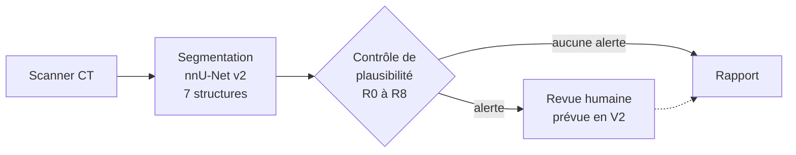

# Segmentation du cœur sur scanner : un pipeline évalué avec une démarche inspirée des dispositifs médicaux

> **In short.** An end-to-end proof of concept that segments 7 cardiac structures on CT scans (public MM-WHS dataset, 20 cases) with nnU-Net v2. 
> A rule-based plausibility check (R0–R8) flags suspicious outputs without knowing the ground truth. 
> Validation follows a protocol frozen before the test set was opened: sealed test set, SHA-256 fingerprints, a single scoring run. 
> Result on 5 test patients: all 7 median Dice scores above their thresholds (verdict: acceptable, indicative only), no silent failure, 2 alerts (1 true, 1 false). 
> Built by a medtech product manager learning AI development, with a team of Claude Code agents; every decision is logged.

Projet personnel, données publiques uniquement.

## Le problème

Connaître l'anatomie de tout le cœur est un **préalable à de nombreuses applications cliniques**, et cette segmentation est **difficile à automatiser** : la forme du cœur varie beaucoup, et la qualité des images aussi (Zhuang et al., 2019, [DOI](https://doi.org/10.1016/j.media.2019.101537)). La segmentation est aussi la première étape de travaux plus vastes : par exemple, construire des modèles numériques du cœur à partir de scanners de patients (Malin et al., 2025, [DOI](https://doi.org/10.1002/mp.17945)). C'est la lecture qui motive ce projet : tant qu'elle reste manuelle ou peu fiable, tout ce qui vient après attend ; c'est un goulot d'étranglement.

La vraie question n'est donc pas seulement « le modèle segmente-t-il bien ? » mais aussi : **comment le prouver, et comment éviter qu'un résultat faux passe sans être vu ?**

## Ce que fait le pipeline

Les 7 structures : myocarde du ventricule gauche (VG), oreillette gauche (OG), cavité du VG, oreillette droite (OD), ventricule droit (VD), aorte ascendante, artère pulmonaire (AP).

## Résultats clés (étape 6, lot de test, 5 patients)

**Verdict : ACCEPTABLE, à titre indicatif** (5 patients seulement). Le pipeline principal (« A ») est un ensemble de 5 modèles nnU-Net, avec post-traitement. TotalSegmentator (« T »), un modèle généraliste public, sert de référence externe, sur les seules structures 1 à 5 dont la définition est comparable.

Dice médian (recouvrement entre prédiction et vérité terrain, de 0 à 1) :

| Structure | Seuil | A (nnU-Net) | T (TotalSegmentator) |
|---|---|---|---|
| Myocarde VG | 0,85 | 0,922 | 0,916 |
| Oreillette gauche | 0,85 | 0,928 | 0,943 |
| Cavité VG | 0,85 | 0,964 | 0,967 |
| Oreillette droite | 0,85 | 0,881 | 0,884 |
| Ventricule droit | 0,85 | 0,902 | 0,914 |
| Aorte ascendante | 0,85 | 0,982 | non comparée |
| Artère pulmonaire | 0,80 | 0,896 | non comparée |

- Les 7 médianes de A dépassent leur seuil ; la marge la plus faible est celle de l'oreillette droite (+0,031).
- **Aucun échec silencieux** : aucune structure n'a un Dice inférieur à 0,50 sans alerte.
- **2 alertes sur 5 cas**, toutes deux de la règle R5 : une vraie (1004, Dice de l'AP à 0,838) et une fausse (1010).
- Sur les structures 1 à 5, les médianes de A et de T diffèrent de 0,015 au plus ; le pire cas de T est plus bas (cavité VG de 1013 : 0,863). C'est une description : le protocole ne prévoit pas de règle pour départager A et T (D46).

Sources : `resultats/etape6/agregats.csv`, `resultats/etape6/alertes.csv`, `resultats/etape6/echecs_silencieux.csv`, décision D46 du journal.

## Comment c'est validé

La démarche reprend celle de la qualification d'un instrument de mesure :

- **Protocole figé avant le test** (`docs/protocole_etape6.md`) : métriques, seuils, règle du verdict et classement des alertes sont fixés et datés avant toute lecture du lot de test. Son empreinte SHA-256 (un code de 64 caractères qui change si un seul octet change) est vérifiée par le script au démarrage (D42).
- **Test scellé** : 5 patients mis de côté dès le début, par patient et non par examen, jamais vus pendant l'entraînement ni les réglages (D16, D20).
- **Code de mesure essayé à blanc d'abord** sur des cas d'entraînement (phase A ; résultat non consigné au journal), puis prédictions produites et figées par empreintes avant l'ouverture (phase B).
- **Ouverture unique pour la mesure** (phase C, le 2026-11-23) : un seul script calcule les métriques sur la vérité du test, une seule fois ; les résultats sont publiés tels quels, chaque déviation est consignée (D43 à D48 ; D48 : vérité d'un cas relue après la clôture, pour une figure seulement, sans aucune mesure).

## Le garde-fou : contrôle de plausibilité

Il juge si une segmentation est vraisemblable, sans connaître la vérité terrain :

| Règle | Ce qu'elle vérifie |
|---|---|
| R0 | Le masque a la même géométrie que le scanner et des étiquettes valides |
| R1 | Chaque structure est présente (plus de 1 mL) |
| R2 | Le volume de chaque structure reste dans la plage observée sur les cas d'entraînement, élargie de 50 % |
| R3 | Le rapport des volumes artère pulmonaire / aorte est plausible |
| R4 | L'aorte et la cavité du VG ont des densités proches (le sang de l'aorte sort du VG) |
| R5 | L'artère pulmonaire et le VD ont des densités proches (le sang de l'AP sort du VD) |
| R6 | L'aorte est au moins aussi dense que l'artère pulmonaire (moment d'injection habituel) |
| R7 | Le produit de contraste est bien présent |
| R8 | Chaque structure n'a qu'un seul morceau de plus de 0,5 mL (pas de fragment égaré) |

R6 et R7 signalent un examen inhabituel (« hors domaine ») ; les autres, une erreur probable. Spécification complète : `docs/specification_controle_plausibilite.md`.

## L'équipe et les outils

- **Agents Claude Code**, chacun avec un rôle (`.claude/agents/`) :
  - `data-engineer` : données, contrôle qualité, formats ;
  - `ml-engineer` : modèles et analyse des résultats ;
  - `qa-reviewer` : relit chaque script avant exécution, chaque chiffre et chaque décision.
- **Outils** : nnU-Net v2, MONAI (métriques, Auto3DSeg / SegResNet en comparaison), TotalSegmentator, MLflow ; exécution dans Google Colab (GPU), données dans Google Drive, jamais dans ce dépôt.
- **Traçabilité** : chaque décision est datée et justifiée dans le journal.

## Limites

- **5 patients de test** : le verdict est indicatif, l'incertitude est grande.
- **Un seul jeu de données public**, une seule convention d'annotation (MM-WHS) ; rien ne dit comment le pipeline se comporte sur d'autres scanners, d'autres centres ou des cœurs pathologiques.
- **Seuils fixés après la validation croisée** (mais avant l'ouverture du test).
- **Contrôle de plausibilité** : sa capacité à détecter les erreurs n'est pas mesurable sur 5 cas ; il juge la vraisemblance, pas l'exactitude.
- **Comparaison avec TotalSegmentator** limitée aux structures 1 à 5 et à 5 patients : elle ne dit pas si un modèle spécialisé ferait mieux sur une autre population.
- **Traçabilité** : une anomalie « +modifié » sur le commit enregistré en phase C, sans effet sur le calcul, de cause non identifiable depuis le dépôt (rapport § 8.3).
- Budget d'entraînement réduit (250 époques au lieu de 1 000). Liste complète : rapport, section 9.

## Et ensuite : la V2

- **Spécialisé contre généraliste, là où ça compte** : comparer un modèle entraîné pour un usage précis, les **cardiopathies congénitales**, à un modèle généraliste comme TotalSegmentator, avec des données et une vérité terrain propres à cet usage.
- **Un garde-fou éprouvé** : mesurer réellement la capacité du contrôle de plausibilité à détecter les erreurs (cas d'échec en nombre suffisant), ajouter un contrôle à l'entrée (scanner sans contraste, moment d'injection inhabituel) et organiser la revue humaine des alertes.

## Pour aller plus loin

- [Rapport technique de validation](docs/rapport_validation_v1.md) : méthodes, résultats détaillés, déviations, limites, références.
- [Journal des décisions](docs/journal_decisions.md) : D16 à D48 (D1 à D15 dans la fiche de cadrage, non publiée).
- [Historique des étapes](docs/historique_etapes.md) : feuille de route détaillée et stratégie face aux cas difficiles.
- Exécution : `notebooks/colab_runner.ipynb`, à ouvrir dans Google Colab.

## Licence et données

Le code de ce dépôt est sous licence MIT (voir `LICENSE`). **Les données MM-WHS n'en relèvent pas** : elles appartiennent à leurs auteurs, sont soumises à leurs propres conditions d'utilisation (site officiel : https://zmiclab.github.io/zxh/0/mmwhs/) et ne sont jamais versionnées ici. Ce dépôt ne contient aucune image tirée de MM-WHS.
